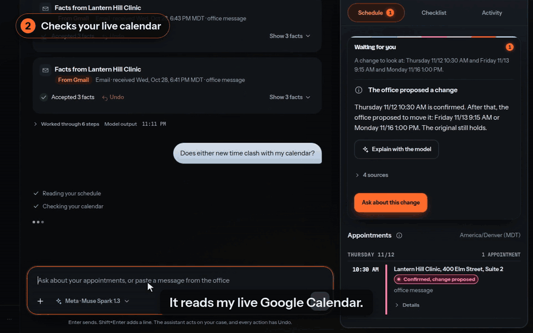
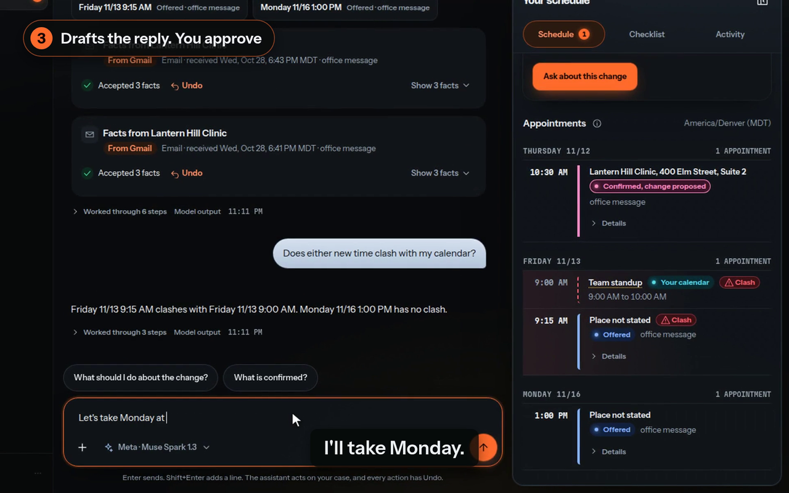
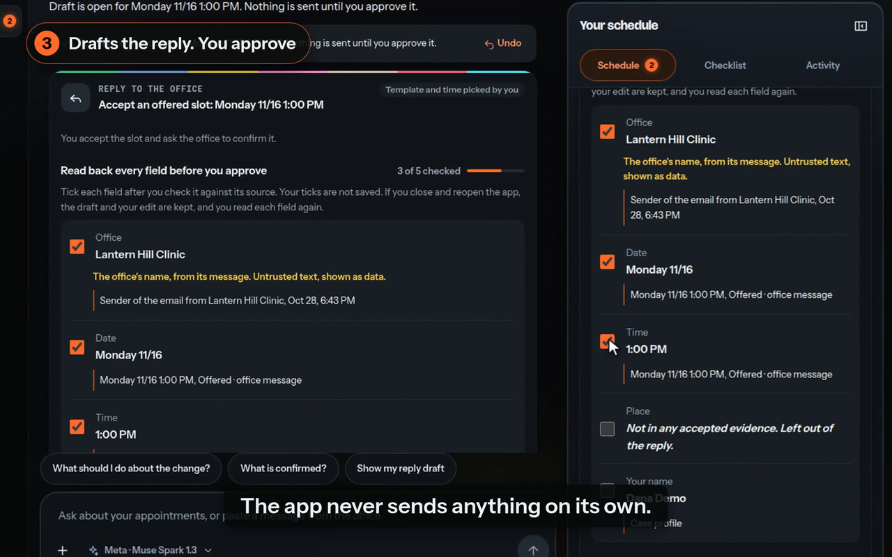
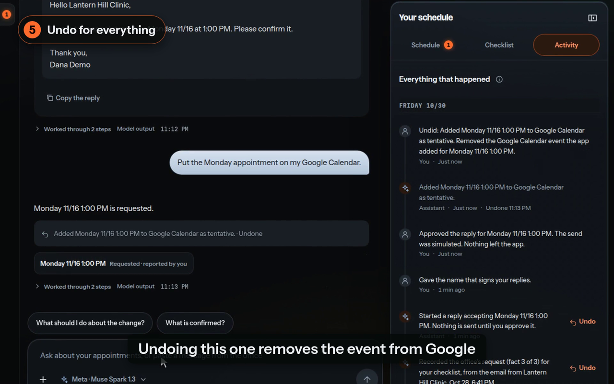
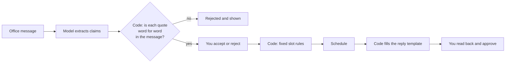
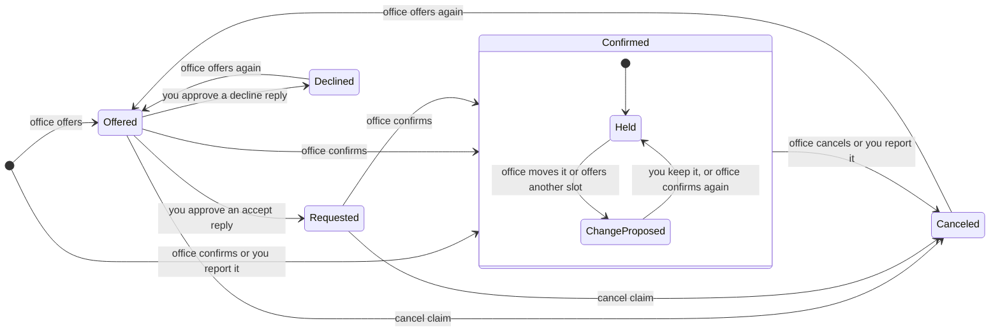

<h1 align="center">Kept</h1>

<p align="center">
  An agent that sorts out appointment changes and drafts replies.
</p>

<p align="center">
  <a href="https://mystic-marvel-866w.here.now/"><strong>Website and demo video</strong></a> &nbsp;·&nbsp;
  <a href="#run-it">Run it</a> &nbsp;·&nbsp;
  <a href="#what-the-model-does-and-what-code-checks">How code checks the model</a>
</p>

<p align="center">
  
</p>

<p align="center"><sub>From the public demo video. Live model, made-up clinic, made-up messages and a made-up calendar. Cut for length.</sub></p>

The clinic confirmed Thursday. Then it emailed to move you. Then it texted two
new options. Kept reads those messages and works out which time is booked. It
checks new times against your calendar and drafts the reply. You read the reply
back and approve it. Kept sends nothing on its own, and most steps have Undo. Approval is final.

## What it does

- Reads a pasted message, or Gmail with your permission.
- Keeps a schedule of each appointment, with the message each fact came from.
- Checks new times against a calendar file or Google Calendar.
- Asks you one question at a time when messages disagree.
- Fills a reply template from the case. You tick each field before you can approve.
- Logs each action in an Activity tab. Each agent action has Undo.

<table>
  <tr>
    <td width="33%"></td>
    <td width="33%"></td>
    <td width="33%"></td>
  </tr>
  <tr>
    <td>The schedule shows a clash with your calendar.</td>
    <td>A field with no accepted evidence stays out of the reply.</td>
    <td>Undo removes the calendar event at Google too.</td>
  </tr>
</table>

## What the model does and what code checks

The model only proposes. Code checks each proposal, and you review what is left.



| The model | Code | You |
| --- | --- | --- |
| Extracts claims from a message | Rejects a claim whose quote is not in the message word for word | Accept or reject each claim |
| Explains a conflict | Requires each cited evidence id to exist and belong to the conflict | Read the sources beside it |
| Picks a reply template and a slot | Fills each field from the case. Rejects a pick that does not match a date or time in your note | Read back each field and approve |
| Answers in the chat and acts on the case | Requires each date, weekday and time in an answer to come from that turn's tool results | Undo any action |

A slot's state comes only from accepted evidence, through a fixed table of rules.
No model output changes a slot. When the order of two claims is unknown, the app
raises a conflict.

The rules exist for real failures. In a live evaluation the model answered
"Please accept Wednesday" with "decline Tuesday". The answer was valid against
the schema and wrong in meaning. Code now rejects a pick that does not match the
dates in your note.

<details>
<summary>Slot states</summary>



Each arrow fires only after you accept the claim in review. The rules are in
[decision 0002](docs/decisions/0002-slot-states.md).

</details>

Other design choices, each with a record in [docs/decisions](docs/decisions):

- **Event log.** The case is an append-only log on `node:sqlite`. Closing and reopening the app restores the case. Readback ticks are not saved, so you read each field again.
- **Delete case.** It runs only from the app, after you type DELETE. It erases the case, then rewrites the database file and empties its WAL.
- **Sending is simulated.** Approval writes a local event, and the UI says "Simulated. Nothing was sent." No network call is made.
- **No fake model in production.** The recorded model clients are test doubles. `test/no-recorded.test.ts` checks that no production path imports them.

## Connect your own agent

An MCP server gives an agent you already use the same tools and rules as the
in-app assistant. It runs over stdio and opens no port.
[docs/connect-agent.md](docs/connect-agent.md) has the command for Grok Build,
OpenCode and Claude Code.

An agent can never approve or send a reply, edit a reply's text, enter a fact by
hand, delete the case, or set a slot's state from its own words. Each action is
in the Activity log as "an external agent", with Undo.

Text from imported messages reaches the agent only in fields named
`untrusted_quote` and `untrusted_text`. That lowers the risk of a message steering
the agent. It cannot remove the risk. The server's own checks do not depend on the
agent following those labels.

An agent with a shell or file tools on the same host is not limited by the MCP
tools. Give agents only the MCP tools.

## Run it

Needs Node 24 and pnpm 10.

```sh
pnpm install
pnpm build
pnpm start
```

<!-- tested: 2026-11-06, clean clone on Ubuntu, Node 24.22.1, pnpm 10.33.2 -->

Open `http://127.0.0.1:5180`.

Add a Meta Model API key in Connections, or sign in with ChatGPT. Then select
**Try the demo**. It loads four made-up messages and a made-up calendar. See
[docs/sign-in.md](docs/sign-in.md). Gmail and Google Calendar are optional and
need your own Google OAuth client ([docs/google.md](docs/google.md)).

```sh
pnpm test
pnpm typecheck
```

<!-- tested: 2026-11-06, clean clone on Ubuntu, Node 24.22.1, pnpm 10.33.2 -->

`pnpm test` needs no network and no key. On the 2026-11-06 clean run, 1,431 of
1,432 tests passed. The ChatGPT live-eval test failed, and `pnpm typecheck` passed.

| Variable | Purpose | Default |
| --- | --- | --- |
| `MODEL_API_KEY` | Meta Model API key, declared in `.env.schema` | None. You can add the key in the app. |
| `APP_ALLOWED_HOSTS` | Host names for a private proxy on the same computer | None. The app binds 127.0.0.1. |
| `APP_MODE` | `hosted` runs the multi-account site ([docs/hosted.md](docs/hosted.md)) | Local mode, one case |

## Stack

TypeScript on Node 24, React 19, Vite, Vitest, `node:sqlite`, Better Auth for
hosted mode, and the MCP SDK.

## Status

In private testing. The [public site](https://mystic-marvel-866w.here.now/) says
`Coming soon` and takes waitlist sign-ups. A sign-in-only hosted instance runs for
hackathon judges, with public sign-up off. There is no tagged release.

- Works, per the repo's records: local mode, the chat agent, Gmail and Google Calendar connections, the MCP server and the demo flow in the video.
- Scope: administrative scheduling. It declines medical questions with a fixed reply that reaches no model.
- Not built: real sending. Send is simulated.
- Tests: the repo holds 123 test files. No GitHub workflow runs them yet, so there is no public green check.

<!-- source: git tree of the prod branch, read 2026-11-06 -->

All people, clinics and messages in this repo are made up.

Kept began as an entry in the Meta Global AI Developer Hackathon (fall 2026),
indie track.

## License

No license file yet. See the repo's LICENSE file when one is added. Until then,
all rights are reserved.
