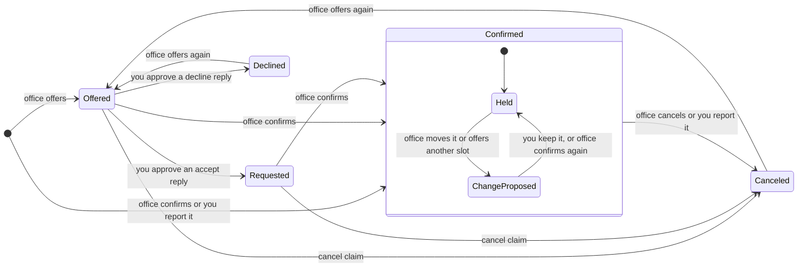
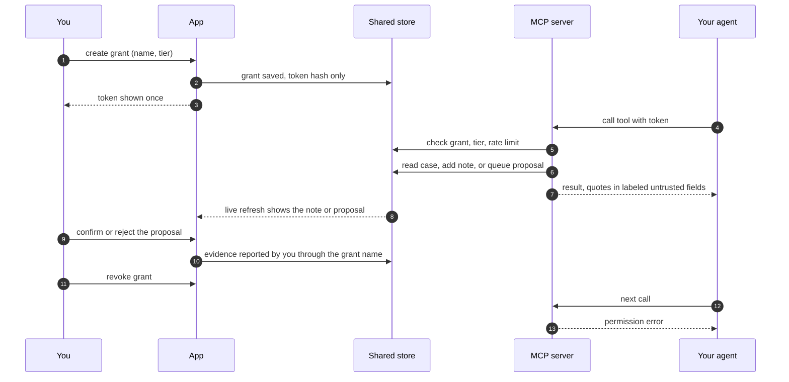

# Diagrams

GitHub renders these Mermaid blocks. They describe the built behavior. The
rules behind them are in `docs/decisions/0002-slot-states.md` and
`docs/decisions/0004-mcp-core.md`.

## Slot states

Every arrow fires only after the user accepts the claim in review. When the
order of two claims is unknown, the app raises a conflict instead of moving
the slot. A possibly stale reminder is asked about once and moves nothing.

## Agent change flow

An agent can read, annotate or propose. Only the user's confirmation in the
app changes a slot.

